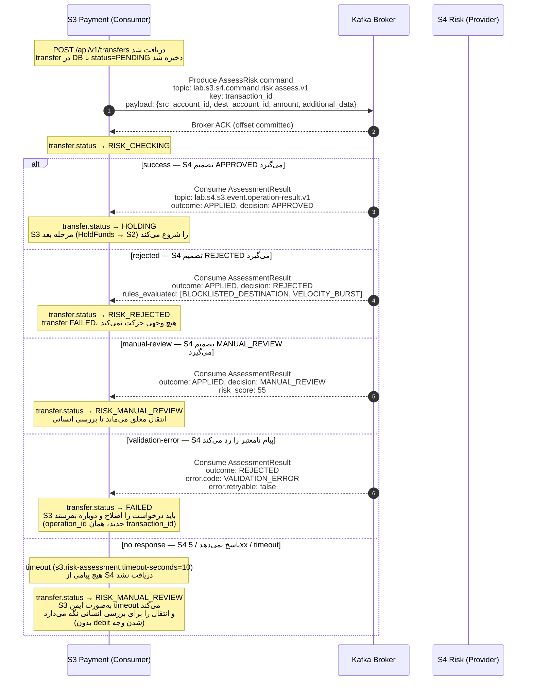

# Sequence Diagram — S3 ↔ S4 (Risk Assessment)

این نمودار تعامل S3 (Payment Orchestration) را به‌عنوان **Consumer** با S4 (Risk &
Fraud Decisioning) به‌عنوان **Provider** نشان می‌دهد. این، نقش Consumer حلقه‌ی
جلسه ۴ است (طبق جدول حلقه: S4 → POST /assessments → Consumer: S3).

در پیاده‌سازی Kafka (ADR-0001)، به‌جای فراخوانی REST همگام:
- S3 پیام `AssessRisk` را در topic `lab.s3.s4.command.risk.assess.v1` تولید می‌کند.
- S4 پیام `AssessmentResult` را در topic `lab.s4.s3.event.operation-result.v1` تولید
  می‌کند و S3 آن را مصرف می‌کند.
- کلید پارتیشن Kafka = `transaction_id` (UTF-8)؛ ترتیب درون‌پارتیشن تضمین می‌شود.

## نمودار (Mermaid)

## مسیرهای پوشش‌داده‌شده

طبق خواسته‌ی تمرین جلسه ۴ (بخش ۶)، حداقل دو مسیر خطا با بلوک `alt`:

| مسیر | outcome | decision | وضعیت نهایی transfer | توضیح |
|------|---------|----------|---------------------|-------|
| موفق | APPLIED | APPROVED | HOLDING | S3 به مرحله‌ی بعد می‌رود |
| خطا ۱ | APPLIED | REJECTED | RISK_REJECTED | انتقال رد می‌شود |
| خطا ۲ | APPLIED | MANUAL_REVIEW | RISK_MANUAL_REVIEW | انتقال معلق |
| خطا ۳ | REJECTED | — | FAILED | S4 پیام را نامعتبر دانست |
| خطا ۴ (no response) | — | — | RISK_MANUAL_REVIEW | S4 پاسخ نداد / 5xx / timeout |

مسیر «no response / 5xx» همان مسیر خطایی است که تمرین صریحاً خواسته است: «یکی از آن
ها وقتی است که همسایه پاسخ نمی‌دهد یا 5xx می‌دهد».

## نکات فنی

1. **Idempotency:** `operation_id` در پاکت پیام، کلید idempotency در سطح منطقی است.
   تکرار همان `operation_id` با همان داده‌ها، همان نتیجه را می‌دهد. S3 با جدول
   `idempotency_keys` در PostgreSQL از اجرای دوباره جلوگیری می‌کند.
2. **Correlation:** `correlation_id` در کل زنجیره ثابت می‌ماند (GEN-08) و در هر خط
   لاگ ظاهر می‌شود. `causation_id` در پاسخ = `message_id` دستوری که آن را_triggered.
3. **ترتیب:** چون key = `transaction_id`، تمام پیام‌های یک انتقال در یک پارتیشن
   می‌روند و ترتیب درون آن پارتیشن حفظ می‌شود. ترتیب بین topicهای مختلف تضمین
   نمی‌شود.
4. **Dedup:** `message_id` در پاکت برای تشخیص تحویل تکراری (broker redelivery) است.
   S3 با ذخیره‌ی `message_id`های پردازش‌شده، idempotency را در سطح پیام تضمین می‌کند.
